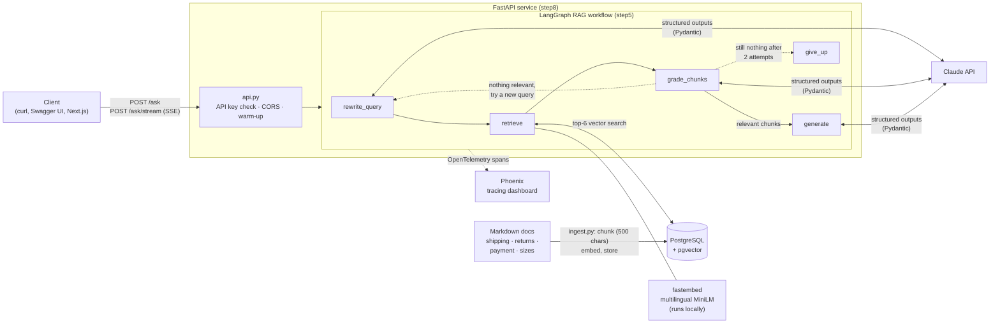
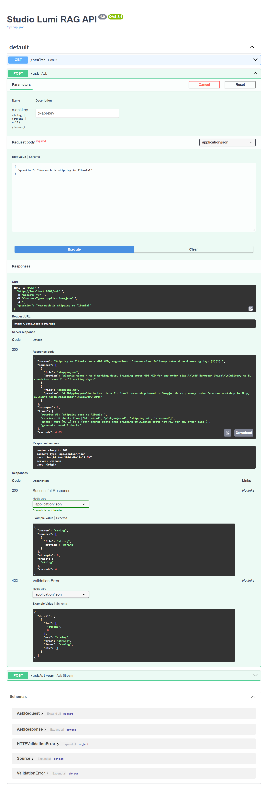

# Experimental: RAG: a multilingual support assistant, from first API call to production

A retrieval-augmented support assistant for a (fictional) dress shop in Skopje. It answers customer questions in **English, Albanian and Macedonian** using only the shop's own documents, and says so when the answer isn't in them.

It's built in eight small steps without a heavy framework, so every piece is visible: the agent loop is written by hand, the RAG pipeline is a LangGraph state machine, quality is measured with an eval suite and an LLM judge, every call is traced, and the result ships as a FastAPI service in a production Docker image.

**Stack:** Python 3.12 · Anthropic Claude API · LangGraph · PostgreSQL + pgvector · fastembed (local multilingual embeddings) · Pydantic · FastAPI · OpenTelemetry + Arize Phoenix · Docker · uv

---

## Architecture



**How a question flows through the graph:**

1. **`rewrite_query`** turns the customer's question (in any of the 3 languages) into a short search query.
2. **`retrieve`** embeds the query locally and pulls the 6 nearest chunks from pgvector.
3. **`grade_chunks`** has the LLM keep only the chunks that actually help answer. Retrieval is deliberately generous; the grader is the filter.
4. If something relevant survived, **`generate`** writes the answer with `[1][2]` citations, in the customer's language, using only those chunks.
5. If nothing survived, the graph loops back with a different query. After 2 attempts it goes to **`give_up`** and says it doesn't know, instead of guessing.

Every node appends to a `trace` list, so each answer comes back with the reasoning path that produced it.

---

## Results: what the evals showed

[`step6/run_evals.py`](step6/run_evals.py) runs the whole graph on a fixed set of **12 questions**: English, Albanian and Macedonian, a multi-hop question, and 2 questions the documents *can't* answer. Each answer is scored three ways:

- **LLM judge** (structured `Verdict`): is the answer *correct* (has the expected facts) and *faithful* (every claim is backed by the retrieved sources)?
- **Keyword check** (deterministic): must-have values such as `400` or `3,000` are in the answer.
- **Source check** (deterministic): the grader kept chunks from the document the answer needs.

Every run is saved as JSON in [`step6/results/`](step6/results/), so versions are compared with numbers instead of impressions.

| Run | What changed | Pass | Correct | Faithful | Sources | Avg. s |
|---|---|---|---|---|---|---|
| baseline | — | 11/12 (92%) | 100% | 92% | 100% | 5.1 |
| topk3 | retrieve 3 chunks instead of 6 | 12/12 (100%) | 100% | 100% | 100% | 4.9 |
| strict-grader | stricter grading prompt | 11/12 (92%) | 100% | 92% | 100% | 4.9 |
| no-retry | no second query attempt | 10/12 (83%) | 100% | 83% | 100% | 4.5 |
| baseline-v2 (×3) | same config, run 3 times | 100% / 92% / 92% | 100% | 100% / 92% / 92% | 100% | 8.2* / 4.7 / 4.7 |
| v3 | judge given the system context | 12/12 (100%) | 100% | 100% | 100% | 4.9 |

<sub>* The first baseline-v2 run includes a cold start: the embedding model loading on the first question took 20.9 s. That's why the API now warms up at startup.</sub>

### The judge bug: the failing test wasn't the system's fault

Every failure in every run had the same shape: **correct = yes, faithful = NO**, and nearly always on the same question: *"Can I return a dress tailored to my measurements?"*

The judge's reason was always a version of:

> *"…it names the company 'Studio Lumi', which appears nowhere in the source."*

At first that looks like a hallucination by the assistant. Reading the traces showed it wasn't:

- The assistant's **system prompt** says it works for Studio Lumi, so using the shop's name is correct behaviour.
- The name appears in only one document, `shipping.md`. A question about **returns** correctly retrieves only `kthimi.md` (returns), so the name isn't in the sources the judge sees.
- The **judge** only saw the question, the retrieved sources and the answer. It had less context than the system it was grading, so it marked correct behaviour as made up.

The three identical `baseline-v2` runs proved the point. With no code changes, the pass rate moved between 100% and 92% depending on whether the model happened to write *"we cover the shipping"* or *"contact Studio Lumi directly"*. The "failure" was the judge reacting to wording, not the system getting worse.

**The fix was in the eval, not the product.** The judge prompt now includes a `<system_context>` block stating that the assistant works for Studio Lumi and that mentioning the name is expected. The next run (`v3`) scored 12/12. That answer also happened not to use the name, so one run doesn't prove the fix by itself, but the cause is clear from the traces.

### What I learned

1. **Evaluate the evaluator.** An LLM judge is a model with its own blind spots. Before believing a failure, read the reason and check the trace. Here, 100% of the "regressions" were judge errors.
2. **Give the judge the same context the system had.** If the system is allowed to know something (a system prompt, a persona, tool results), the judge must know it too, or correct behaviour will be scored as made up.
3. **Run it more than once.** On 12 cases one question is about 8 points. The same code scored 100%, 92%, 92% across three runs, so the jump from `baseline` to `topk3` (92% → 100%) is noise, not proof that 3 chunks beat 6.
4. **The eval set is saturated.** Correctness and source selection are 100% in every run, and retrieval never failed because the corpus is only a handful of chunks. To tell versions apart, the next step is harder cases: more documents, near-duplicate passages, and more multi-hop and unanswerable questions.
5. **The one hint of a real effect:** `no-retry` saves about 0.6 s per question (~12%) but has the most failures. It's a cost/quality trade-off worth measuring properly with repeated runs.

---

## Other experiments

**Context budget in the hand-written agent (step 3).** Cutting the agent's tool output from 4,000 to 200 characters reduced input tokens by about a third (≈8.4k → ≈5.6k) with no loss in pass rate or steps across 9 runs. The agent made up for the missing error messages by reading the source files directly. Switching the trimming to keep both the beginning and the end didn't help here either: unittest prints its tracebacks in the *middle* of the output, not at the end. Lesson: what the agent can see matters more than how much, and it depends on the output format.

---

## Project layout

Each step is a small, runnable folder. Later steps reuse earlier ones instead of copying them.

| Step | Folder | What it does |
|---|---|---|
| 1 | [`step1/`](step1/) | Chat loop: the `messages` list *is* the model's memory |
| 2 | [`step2/`](step2/) | Structured extraction: messy invoice text → validated Pydantic `Invoice`, with a business-rule validator |
| 3 | [`step3/`](step3/) | Agent loop by hand: `list_files` / `read_file` / `write_file` / `run_python` tools, step limit, sandboxed workspace, output trimming |
| 4 | [`step4/`](step4/) | Basic RAG: chunk → embed (local, multilingual) → pgvector → answer with citations |
| 5 | [`step5/`](step5/) | The same RAG as a LangGraph workflow with query rewriting, chunk grading and retry/give-up routing |
| 6 | [`step6/`](step6/) | Eval suite: 12-case dataset, LLM judge + deterministic checks, saved runs |
| 7 | [`step7/`](step7/) | Observability: OpenTelemetry auto-instrumentation of Claude and LangGraph, sent to Phoenix; evals traced one case per trace |
| 8 | [`step8/`](step8/) | FastAPI service: `/ask`, `/ask/stream` (Server-Sent Events), optional API key, CORS, startup warm-up, non-root production image with health check |

---

## How to run it

**Requirements:** Docker Desktop (or Docker Engine) and an Anthropic API key.

```bash
cp .env.example .env            # add your ANTHROPIC_API_KEY
docker compose --profile rag up -d --build
docker compose exec app python step4/ingest.py   # chunk + embed the docs into pgvector (once)
```

**Ask a question through the graph:**

```bash
docker compose exec app python step5/graph_rag.py "How much is shipping to Kosovo?"
docker compose exec app python step5/graph_rag.py "Sa ditë kam kohë për ta kthyer një fustan?"
```

**Run the evals** (the label names the saved results file):

```bash
docker compose exec app python step6/run_evals.py my-change
```

**Tracing:** start Phoenix, then open <http://localhost:6006>.

```bash
docker compose --profile obs up -d
docker compose exec app python step7/traced_rag.py "How much is shipping to Kosovo?"
docker compose exec app python step7/traced_evals.py v3-traced
```

**The API (dev, with live reload and tracing):**

```bash
docker compose --profile rag --profile obs --profile api up -d --build
curl -X POST http://localhost:8000/ask -H "Content-Type: application/json" \
     -d '{"question": "How much is shipping to Kosovo?"}'
curl -N -X POST http://localhost:8000/ask/stream -H "Content-Type: application/json" \
     -d '{"question": "A mund të paguaj me kartelë?"}'
```

Interactive docs: <http://localhost:8000/docs>.

**The API (production image):**

```bash
docker build -f step8/Dockerfile.prod -t ai-lab-api .
docker run --rm -p 8001:8000 --env-file .env --network ai-lab_default ai-lab-api
```

The production image copies only the four files the API needs (never `.env`), runs as a non-root user, downloads the embedding model at build time so containers start fast, and has a Docker `HEALTHCHECK`.

| Env var | Purpose |
|---|---|
| `ANTHROPIC_API_KEY` | Required |
| `ANTHROPIC_MODEL` | Claude model for every step (default `claude-sonnet-5-5`) |
| `API_KEY` | If set, clients must send it in the `X-API-Key` header |
| `ALLOWED_ORIGINS` | CORS origins, comma-separated (default `http://localhost:3000`) |
| `TRACING=1` | Send traces to Phoenix |

A Next.js client for the streaming endpoint is in [API.md](API.md). The full step-by-step learning guide, VS Code setup and troubleshooting are in [LEARNING_PATH.md](LEARNING_PATH.md).

---

## Screenshots

**The API in Swagger UI:** a real `/ask` call returns the answer, the source chunks, and the graph's decision trace (rewrite → retrieve → grade: kept 2 of 6 → generate) in 4.65 s.



**Phoenix tracing, projects:** traces from the RAG app are collected in their own project.


**Phoenix tracing, a request:** one `rag_request` span with its input and output, traffic by status, and latency (P50 6.3 s).


